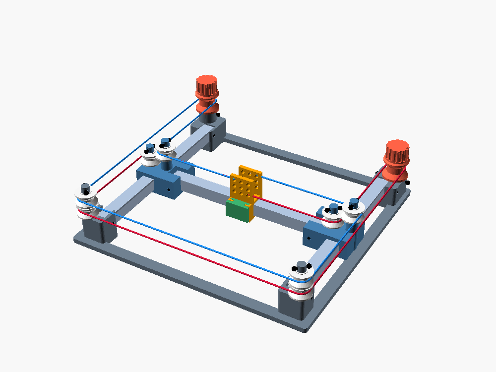
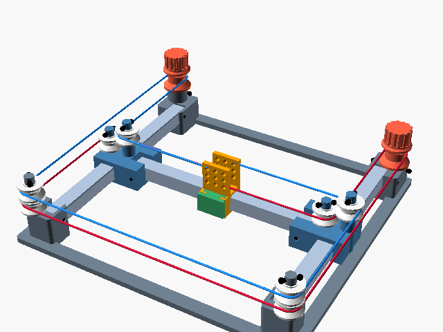
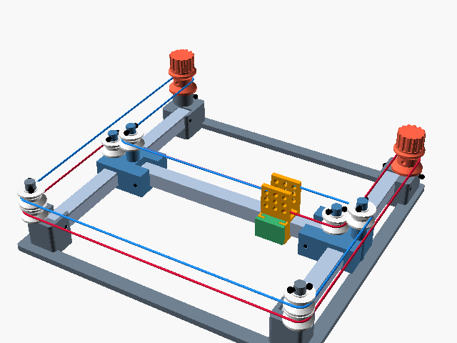

# String CoreXY Toy

A hand-cranked CoreXY you can hold in your hand. All the structural parts are 3D printed. The belts are two loops of cotton yarn and the screws are bits of 1.75 mm filament.

  
  
  
  
  

I wanted to finally understand how CoreXY works, so I designed one, printed it and played with it until it clicked. Turn both knobs the same way and the carriage moves in X. Turn them opposite ways and it moves in Y. Turn one alone and it goes diagonally.

  

The idea came from the [Manual CoreXY Mechanism](https://makerworld.com/en/models/1576726-manual-corexy-mechanism) ([video](https://youtu.be/tElMsCfxDCs)), which uses some non-printed parts. This is a new design, written from scratch in OpenSCAD.

## Printing

Everything in [`stl/`](stl) is already in print orientation, one file per copy, so drop the whole folder into your slicer. I print it all on one plate on a Creality Hi with PLA, 0.4 mm nozzle, 0.2 mm layers, 2 walls, 5% lightning infill, tree (auto) supports with "on build plate only" turned off, and ironing on top surfaces. Turn hole compensation off. It takes about 3 h 15 min and 50 g. `head_blank.stl` is optional.

The clearances suit my printer. If parts come out too tight or too loose, you can re-export with your own values (see the build guide).

Besides the printed parts you need two pieces of thin cotton yarn (about 1.1 mm, 80 cm each), about 25 cm of 1.75 mm filament for pins, side cutters, and a lighter or soldering iron to melt the pin ends.

## Building it

Assembly, the pin cut list and the full stringing route are in [docs/build.md](docs/build.md). The video doesn't show all of the stringing, so follow the written route.

Fit every pulley with its raised ring at the bottom. The model and renders have it on top, but the real toy runs better with the pulleys flipped.

The same file covers changing the size, exporting STLs with `build.py`, and making your own heads for the carriage.

## License

MIT, see [LICENSE](LICENSE).
